# Habita

**Vea cómo quedan muebles reales en su espacio antes de comprarlos.**

Habita es una app móvil que ayuda a escoger muebles para la casa. La persona toma una foto de su
cuarto, sala o cocina, escribe lo que quiere (por ejemplo, *"un sofá con cojines y una alfombra"*)
y la app:

1. analiza los colores y el estilo de la foto,
2. busca muebles **reales** en Éxito y Falabella que combinen con ese espacio,
3. dibuja cada mueble **dentro de la foto** para ver cómo quedaría,
4. muestra el **precio real** y el **enlace** para comprarlo.

Proyecto final de **Diseño de Interfaces de Software**. Todo funciona de verdad: no hay datos
simulados ni pantallas de relleno. El servidor corre en la nube y la app se abre con Expo Go.

<p align="center">
  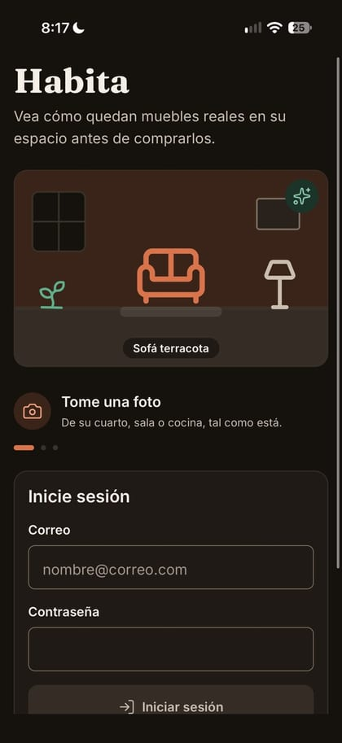
  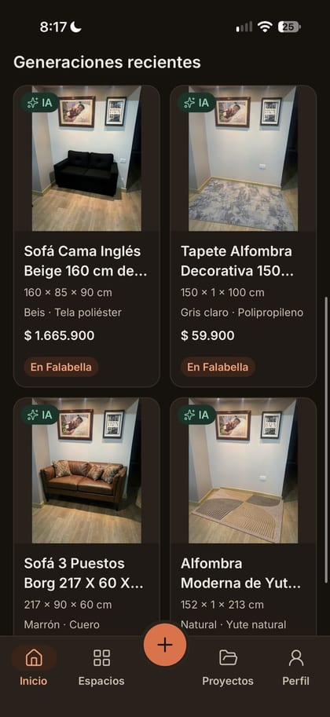
  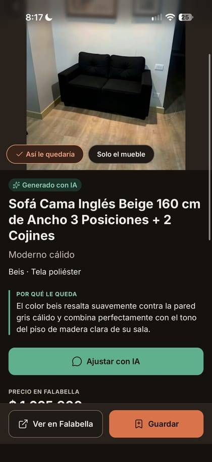
</p>

---

## Contenido

- [El problema](#el-problema)
- [Recorrido por la app](#recorrido-por-la-app)
- [Funcionalidades](#funcionalidades)
- [Diseño de la interfaz](#diseño-de-la-interfaz)
- [Cómo funciona por dentro](#cómo-funciona-por-dentro)
- [Arquitectura y tecnologías](#arquitectura-y-tecnologías)
- [API](#api)
- [Seguridad y cuentas](#seguridad-y-cuentas)
- [Cómo correrlo](#cómo-correrlo)
- [Despliegue](#despliegue)
- [Decisiones y límites](#decisiones-y-límites)

---

## El problema

Comprar un mueble sin verlo en la casa es una apuesta: no se sabe si combina con la pared y el
piso, si se ve muy grande o dónde quedaría mejor. Las tiendas muestran el mueble en salas de
catálogo, no en el espacio de cada persona.

Habita responde tres preguntas con una foto y una frase: **¿qué me queda bien?, ¿cómo se vería
en mi casa? y ¿dónde lo compro y cuánto cuesta?**

---

## Recorrido por la app

### 1. Iniciar sesión


La primera pantalla presenta la idea de la app con una **escena animada**: un cuarto donde los
muebles caen y se acomodan en el piso, cambiando de tipo y color cada pocos segundos, mientras una
línea recorre el cuarto como la IA cuando mira una foto. Debajo rotan los tres pasos de la app.

Cada persona tiene su cuenta: sus espacios, diseños y proyectos se guardan en el servidor y se
ven desde cualquier teléfono. Si el teléfono tiene activado *Reducir movimiento*, las animaciones
se detienen.

<br clear="right" />

### 2. Inicio

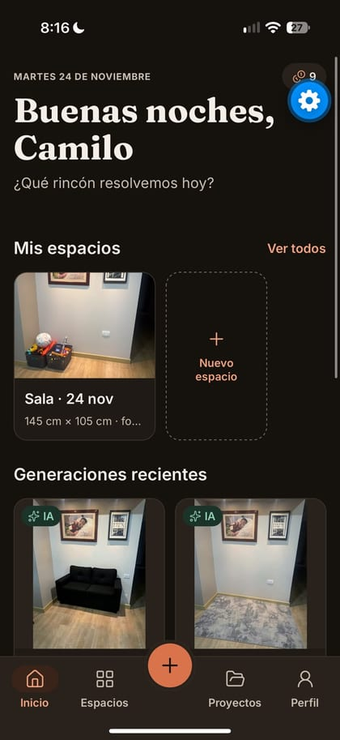

Saludo con la fecha y el nombre, **Mis espacios** (fotos guardadas de la casa) y
**Generaciones recientes**. Si quedó un diseño a medio hacer, aparece un aviso para continuarlo.

La barra inferior tiene cuatro pestañas (Inicio, Espacios, Proyectos y Perfil) y un **botón
central** que abre el flujo para diseñar.

<br clear="right" />

### 3. ¿Dónde va el mueble? (paso 1 de 3)

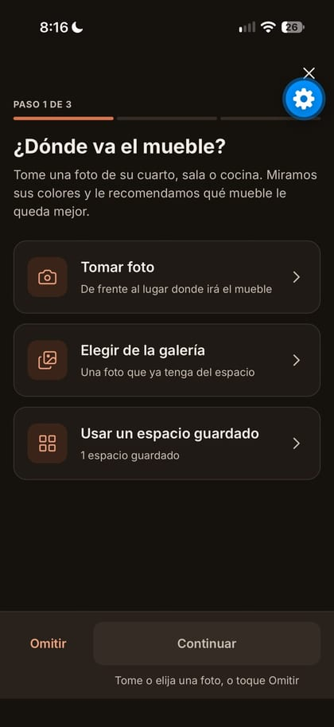

Tres opciones: **tomar una foto**, **elegirla de la galería** o **usar un espacio guardado**.
También se puede omitir.

La foto se sube y se analiza **en segundo plano**: la persona sigue al siguiente paso sin
esperar.

<br clear="right" />

### 4. ¿Qué le gustaría? (paso 2 de 3)

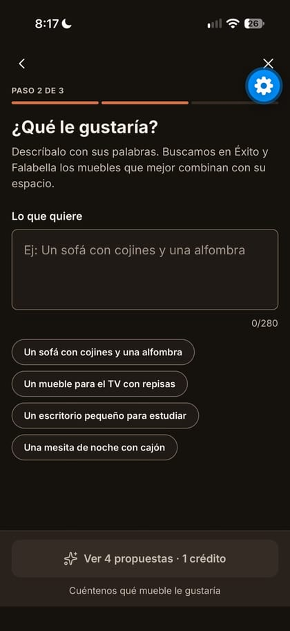

Un solo campo de texto, con ejemplos que se tocan para llenarlo. Aquí aparece lo que la IA vio en
la foto: el tipo de espacio, su estilo y su paleta de colores.

**No se piden medidas, material, presupuesto ni tipo de mueble.** Las primeras versiones de la
app los pedían, y en las pruebas se sentía complicada; ahora esa decisión la toma la IA a partir
de la foto y la descripción.

Si el espacio está desordenado, **Ordenar mi espacio** quita de la foto cajas, ropa y objetos
sueltos antes de poner los muebles.

<br clear="right" />

### 5. Diseñando (paso 3 de 3)

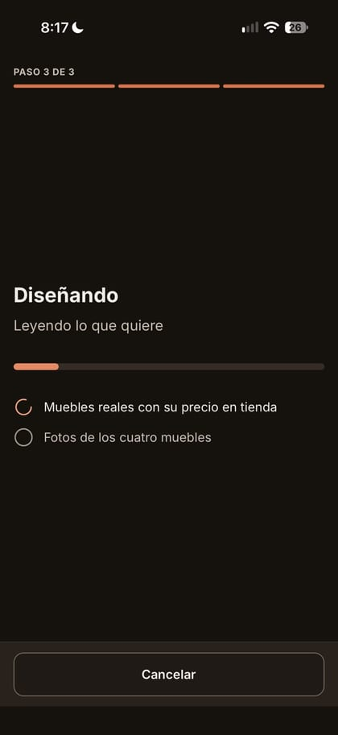

Una barra de progreso y mensajes que cambian según **la etapa real** en la que va el servidor
(buscando muebles, trayendo las fotos, poniéndolos en su foto), nunca adelantándose. Se puede
cancelar, y en ese caso el crédito se devuelve.

<br clear="right" />

### 6. Resultados


Arriba, **Nuestra recomendación**: dos o tres frases que nombran los colores reales del espacio y
explican qué tipo de mueble y qué color le conviene.

Debajo, **cuatro muebles reales** de Éxito y Falabella en una rejilla de dos columnas, cada uno
con su foto dentro del espacio de la persona, precio, medidas, material y la tienda. Se pueden
reordenar (recomendadas, menor precio, más compactas) y comparar lado a lado.

<br clear="right" />

### 7. Detalle: así le quedaría


La imagen principal muestra el mueble **dentro de la foto real**; con *Solo el mueble* se ve la
foto de la tienda.

Luego vienen el nombre, el estilo, el color y el material, y **Por qué le queda**: una explicación
basada en los colores del espacio. Después van el precio en la tienda, una ficha técnica y el
recuadro **Disponible en Falabella** (o Éxito), que abre la página del producto para comprarlo.

<br clear="right" />

### 8. Ajustar con IA

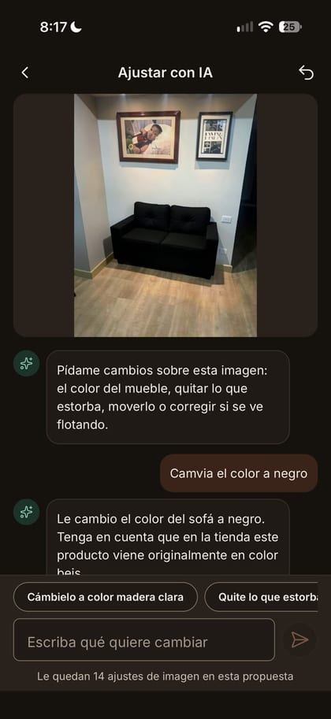

Un chat para pedir cambios sobre la imagen con palabras: *"cámbialo a color negro"*,
*"hazlo más pequeño"*, *"muévelo a la izquierda"*, *"quita lo que estorba"*. La IA decide si hay que
editar la imagen o volver a dibujar el mueble en otro lugar, y responde explicando lo que hizo.
Cuando cambia el color de un producto de tienda, aclara que en la tienda viene en su color
original. Cada cambio se puede deshacer.

<br clear="right" />

### 9. Proyectos y Perfil

<p>
  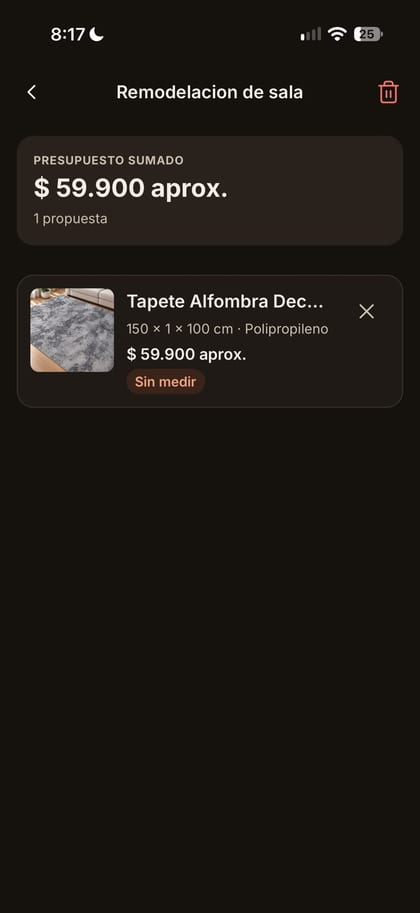
  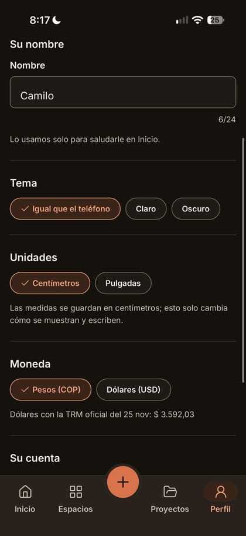
</p>

Los muebles se guardan en **proyectos** (por ejemplo, *Remodelación de sala*) que suman el
presupuesto total. En **Perfil** se cambia el nombre, el **tema** (claro, oscuro o el del teléfono),
las **unidades** (centímetros o pulgadas) y la **moneda** (pesos o dólares, con la TRM oficial del
día).

---

## Funcionalidades

| | |
|---|---|
|  **Análisis de la foto** | Tipo de espacio, estilo, paleta de colores, piso, luz y zona libre para el mueble. |
|  **Muebles reales** | Búsqueda en Éxito y Falabella; la IA elige los que combinan y descarta fundas o accesorios. |
|  **Así le quedaría** | El mueble de la tienda dibujado dentro de la foto, respetando paredes, piso, perspectiva y luz. |
|  **Ordenar mi espacio** | Quita cajas, ropa y objetos sueltos de la foto; deja paredes, piso, enchufes y muebles grandes. |
|  **Ajustar con IA** | Cambios por chat (color, tamaño, posición) con historial y opción de deshacer. |
|  **Precio y enlace reales** | El precio de la tienda al momento de buscar, y el enlace a la página del producto. |
|  **Proyectos** | Agrupar muebles y ver el presupuesto sumado. |
|  **Créditos** | 10 de bienvenida; cada diseño cuesta 1 y se devuelve si falla o se cancela. |
|  **Modo oscuro** | Tema claro, oscuro o el del sistema, con contraste AA en los dos. |
|  **Cuentas** | Registro e inicio de sesión; los datos se ven desde cualquier teléfono. |

---

## Diseño de la interfaz

### Sistema de diseño

Todos los valores visuales viven en un archivo de **tokens** (`mobile/src/theme/tokens.ts`) y las
pantallas los consumen desde ahí; ningún componente tiene colores o medidas sueltas.

- **Color:** paleta cálida (terracota como color de marca, verde salvia para lo que hace la IA)
  con una versión oscura de cada token. Todos los pares de texto y fondo cumplen **contraste AA**.
- **Tipografía:** *Fraunces* para el título grande de cada pantalla e *Inter* para todo lo demás,
  en 11 estilos (de `displayLg` a `labelSm`).
- **Espaciado y forma:** retícula de 4 px, margen lateral de 16, radios según el tipo de elemento
  (campos 8, botones 12, tarjetas 16, hojas 24).
- **Iconos:** Lucide, a 24 px con trazo 1,75.

### Componentes reutilizables

`Boton`, `BotonIcono`, `CampoTexto`, `Chip`, `Etiqueta`, `TarjetaMueble`, `TarjetaEspacio`,
`BarraSuperior`, `BarraInferior`, `Pasos`, `HojaInferior`, `Aviso`, `Toast`, `EstadoVacio`,
`Esqueleto`, `Aparecer`, `EscenaCuarto` y otros (`mobile/src/componentes`). Ninguna pantalla
redefine estilos de algo que ya existe.

### Reglas que sigue toda la app

- **Una sola acción principal** (relleno de color de marca) por pantalla.
- **Tres estados en cada pantalla:** cargando (con esqueletos, no con ruedas), vacío y error.
- **Los errores dicen qué pasó y qué sigue**, por ejemplo: *"No pudimos terminar el diseño. El crédito
  no se descontó"*.
- **Un botón deshabilitado siempre explica por qué**, por ejemplo: *"Tome o elija una foto, o toque
  Omitir"*.
- **El color nunca es la única señal** de un estado: siempre va con texto o icono.
- **Área táctil mínima de 48 px** y etiquetas de accesibilidad en imágenes y controles.
- **Volver atrás nunca borra lo escrito:** el borrador del flujo se guarda en el teléfono.
- **Movimiento con propósito:** entradas escalonadas, la escena del inicio de sesión y el progreso.
  Todo se detiene si el teléfono pide reducir el movimiento.

### Voz

Frases cortas, con el verbo al principio y sin jerga técnica: *"Tome una foto"*, *"Buscando
muebles en Éxito y Falabella"*, *"Mida el espacio antes de fabricar"*.

---

## Cómo funciona por dentro

Lo que pasa entre tocar **Ver 4 propuestas** y ver los resultados:

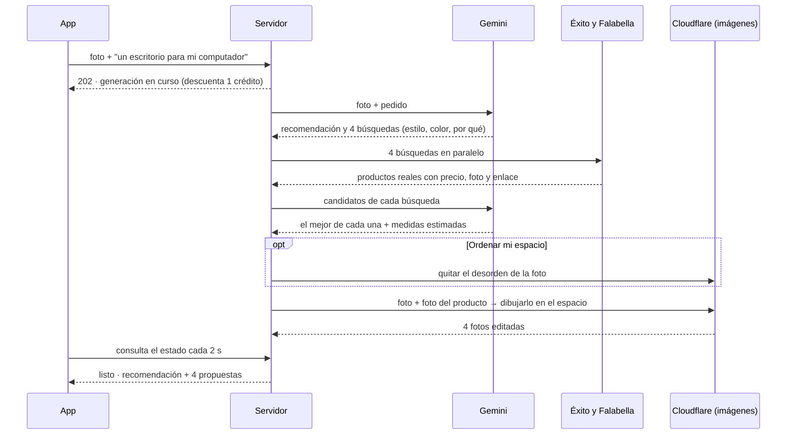

- **El precio no lo inventa la IA:** es el que publica la tienda.
- **La foto editada usa la foto real del producto como referencia**, para que el mueble que se ve
  en el cuarto sea el mismo que se compra.
- Si Gemini está saturado, el servidor prueba **una cadena de seis modelos** antes de rendirse, y
  no deja a la persona esperando más de 100 segundos.
- Si algo falla, la generación se marca con error y **el crédito se devuelve** automáticamente.

---

## Arquitectura y tecnologías

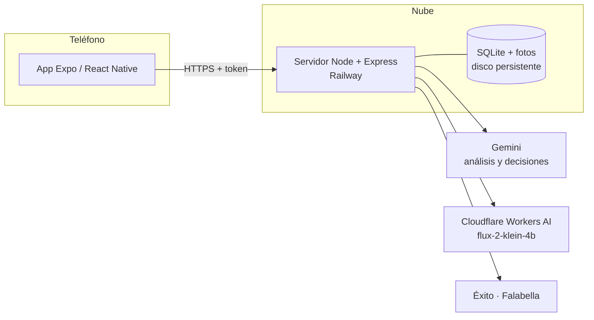

| Parte | Tecnología |
|---|---|
| App | **Expo SDK 58** (React Native) con **TypeScript**, **Expo Router** (navegación por archivos), Zustand (estado), expo-image, expo-image-picker, expo-secure-store, Lucide |
| Servidor | **Node 24** + **Express 5**, TypeScript ejecutado directo por Node, **SQLite** (`node:sqlite`), sharp (imágenes), multer (subidas) |
| IA de texto y visión | **Gemini** (Google AI Studio) con respuestas en JSON validadas por esquema |
| IA de imágenes | **Cloudflare Workers AI**, `flux-2-klein-4b` en modo edición |
| Datos de tiendas | Búsqueda pública de Éxito y resultados de búsqueda de Falabella |
| Moneda | TRM oficial de **datos.gov.co**, guardada una vez al día |
| Nube | **Railway** (servidor y disco) y **EAS Update** (publicación de la app) |

### Estructura del proyecto

```
mobile/
  src/app/            pantallas (Expo Router): (tabs), nuevo/, propuesta/, ajustar/, ingresar, registro…
  src/componentes/    sistema de componentes reutilizables
  src/theme/          tokens de diseño (claro y oscuro) y tema
  src/servicios/      única capa de llamadas a la API y tipos
  src/store/          sesión, preferencias y borrador del flujo
  src/lib/            formato, flujo, foto del espacio
server/
  src/rutas/          endpoints (cuentas, fotos, espacios, generaciones, ajustes, proyectos)
  src/lib/            generación, tiendas, análisis, edición en la foto, chat, créditos, precio
  src/ia/             clientes de Gemini y Cloudflare
docs/capturas/        capturas de este README
```

---

## API

Base: `/api`. Todo exige sesión (`Authorization: Bearer <token>`) excepto `/salud` y `/cuentas/*`.

| Método | Ruta | Qué hace |
|---|---|---|
| GET | `/salud` | Comprueba que el servidor responde |
| POST | `/cuentas/registro` · `/cuentas/ingreso` · `/cuentas/salida` | Crear cuenta, iniciar y cerrar sesión |
| GET | `/cuentas/yo` | Datos de la cuenta |
| GET | `/catalogos` | Catálogos y TRM vigente |
| GET | `/creditos` · `/creditos/movimientos` | Saldo y movimientos |
| POST | `/fotos` | Sube una foto (multipart) |
| POST | `/fotos/analisis` | Analiza la foto: espacio, estilo, colores, zona libre |
| GET · POST · PUT · DELETE | `/espacios`, `/espacios/:id` | Espacios guardados |
| POST | `/generaciones` | Empieza un diseño (responde 202) |
| GET | `/generaciones` · `/generaciones/:id` | Recientes y estado (etapa, recomendación, propuestas) |
| POST | `/generaciones/:id/cancelar` | Cancela y devuelve el crédito |
| GET | `/propuestas/:id` | Detalle de un mueble |
| GET · POST | `/propuestas/:id/ajustes` | Historial y nuevo ajuste por chat |
| POST | `/propuestas/:id/ajustes/deshacer` | Deshace el último ajuste |
| GET · POST | `/proyectos`, `/proyectos/:id` | Proyectos con presupuesto sumado |
| POST · DELETE | `/proyectos/:id/propuestas(/:propuestaId)` | Guardar o quitar un mueble |

La generación corre en segundo plano y su `etapa` avanza por `propuestas` → `imagenes` →
`ubicando` → `listo`; la app la consulta cada 2 segundos.

---

## Seguridad y cuentas

- **Las llaves de las APIs viven solo en el servidor** (variables de entorno). La app nunca las ve:
  todo lo que usa IA pasa por el servidor.
- **Contraseñas cifradas con `scrypt`**, nunca guardadas en texto.
- **Sesión con un token aleatorio.** En el teléfono se guarda en el llavero (SecureStore); en el
  servidor solo se guarda su hash `sha256`.
- **Protección contra fuerza bruta:** tras 5 intentos fallidos con el mismo correo hay que esperar
  5 minutos.
- **Cada cuenta solo ve sus propios datos:** espacios, diseños, proyectos y créditos.
- **Validación en el servidor** de todo lo que llega, incluidas las rutas de fotos.

---

## Cómo correrlo

**Requisitos:** Node 24 y la app **Expo Go** en el teléfono.

### Servidor

```bash
cd server
npm install
```

Crear `server/.env` (no se sube al repositorio):

```
GEMINI_API_KEY=...
CLOUDFLARE_ACCOUNT_ID=...
CLOUDFLARE_API_TOKEN=...
```

```bash
npm run dev            # http://localhost:3000/api
```

### App

```bash
cd mobile
npm install
```

En `mobile/.env`, la dirección del servidor:

```
EXPO_PUBLIC_API_URL=http://<ip-del-computador>:3000
```

```bash
npx expo start         # escanear el QR con Expo Go
```

El teléfono y el computador deben estar en la misma red. En el emulador de Android la dirección es
`http://10.0.2.2:3000`.

---

## Despliegue

- **Servidor en Railway.** Se despliega solo con cada `git push`. La base SQLite y las fotos van
  en un **disco persistente** (`DATOS=/data`), así que no se pierden entre despliegues.
- **App con EAS Update.** Se publica en un canal fijo (`main`); al abrir el proyecto en Expo Go se
  descarga la última versión, sin depender del computador ni de la red local.

---

## Decisiones y límites

**Lo que se probó y se descartó:**

- **Precios calculados.** Al principio la app diseñaba muebles a medida y estimaba el precio con
  el despiece. Los precios no se sentían reales, así que se cambió a productos de tienda con
  precio y enlace.
- **Mercado Libre, Alkosto y Facebook Marketplace.** Mercado Libre exige cuenta de desarrollador,
  Alkosto solo se podría consultar usando una llave interna de su página, y Facebook prohíbe
  extraer datos. Se usan solo fuentes públicas.
- **Pegar el mueble sobre la foto.** Se veía plano y sin perspectiva. Dibujarlo con IA usando la
  foto real del producto como referencia da un resultado mucho más creíble.

**Límites conocidos:**

- **Las medidas son aproximadas:** las estima la IA a partir de la foto y del nombre del producto.
  La app lo indica y recomienda medir antes de comprar.
- **El precio y la disponibilidad pueden cambiar** después de la búsqueda; el enlace lleva a la
  página vigente.
- **Cupos gratis de IA:** Cloudflare da una cuota diaria de imágenes que alcanza para unos 20
  diseños al día, y Gemini puede saturarse en horas pico. La app reintenta con modelos de
  respaldo y, si no lo logra, avisa y devuelve el crédito.
- **La edición de la foto es una aproximación visual:** a veces el mueble trae decoración de la
  foto de la tienda o el tamaño no es exacto.

---

Hecho por **[Ju4nK1807](https://github.com/Ju4nK1807)** · Diseño de Interfaces de Software · 2026
